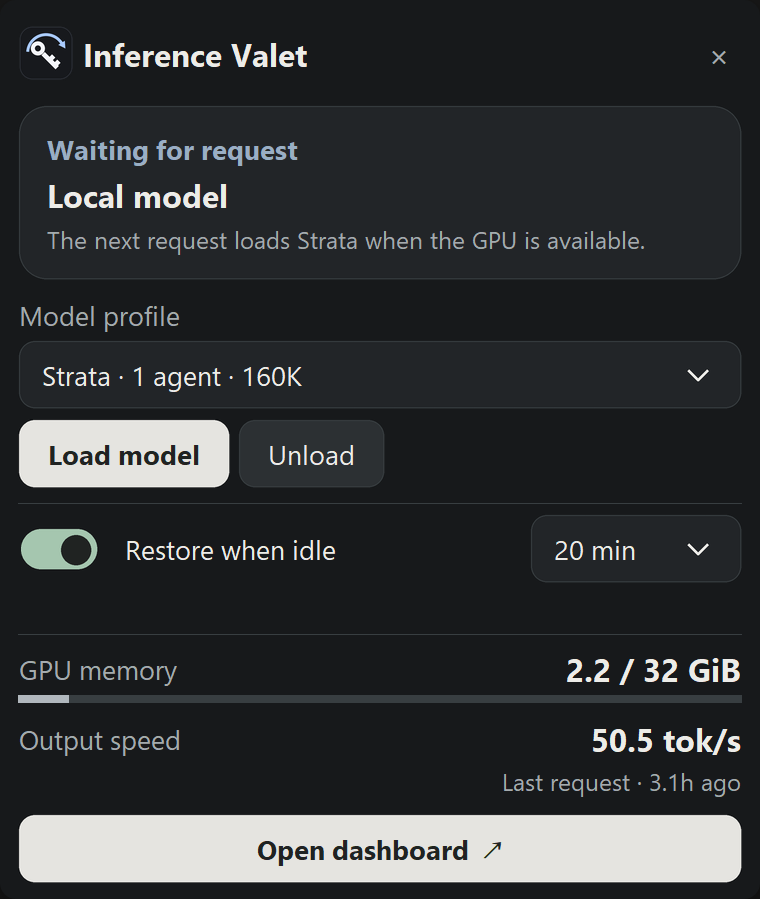
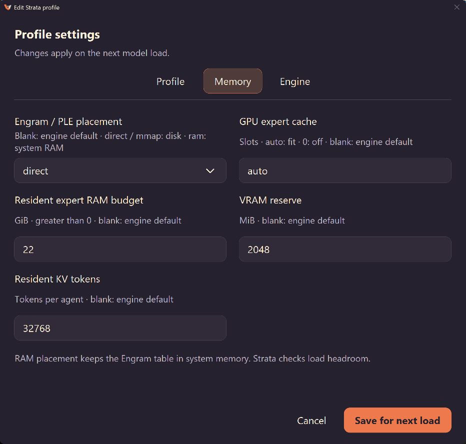
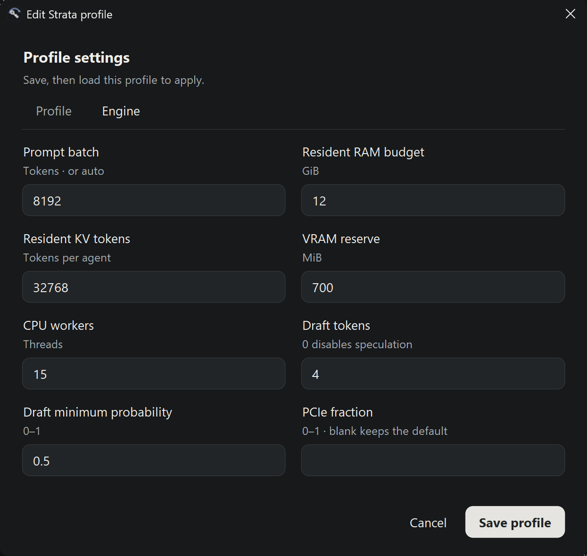

<p align="center"></p>

<h1 align="center">Inference Valet</h1>

<p align="center"><b>Your GPU when you game. Your model when you need it.</b><br>
Automatic game detection, model loading and idle restore for Strata on Windows.</p>

<p align="center">
  
  
  
  <a href="LICENSE"></a>
</p>

<p align="center"><a href="https://github.com/shiftedx/inference-valet/releases/tag/v0.3.0">Download v0.3.0</a> · <a href="#run">Install</a> · <a href="docs/SETUP.md">Configure</a> · <a href="AGENTS.md">Agents</a> · <a href="BRANDING.md">Branding</a></p>

<p align="center"><a href="docs/assets/panel.png"></a></p>

| Automatic game detection | Automatic model loading |
|---|---|
| Detect Steam games, Windows game records, configured executables and fullscreen/presentation activity. Block new loads; optional on-demand mode unloads after its game grace period. | Eager mode restores the last profile after **5–30 idle minutes**. Optional on-demand mode loads on the first request when games and resource guards permit. |
| **Native controls** | **Performance at a glance** |
| Load, switch, unload; close to tray. Edit context, agents, KV, reasoning/output limits and engine tuning. Saved changes apply on the next profile launch. | Backend-supported timing, GPU/RAM, clocks, temperature, memory activity, power and Strata active-power average. Scrollable technical tables; validated engine settings apply on the next load. |

<p align="center"></p>


<details>
<summary>Tray and profile settings</summary>
<p align="center"><a href="docs/assets/tray.png"></a></p>
<p align="center">
<a href="docs/assets/profile-editor.png"></a>
<a href="docs/assets/memory-editor.png"></a>
<a href="docs/assets/engine-editor.png"></a>
</p>
</details>

- **Memory activity:** VRAM read/write busy time; capacity: GiB meter.
- **Strata avg:** whole-GPU power sampled during Strata work; resets when Valet restarts.

## Run

**Windows 10/11 · NVIDIA GPU / `nvidia-smi` · Python ≥3.11 with Tcl/Tk · installed [Strata](https://github.com/Niko1221/Strata) and model files.** This managed integration targets NVIDIA; unavailable readings display `—`.

```powershell
git clone https://github.com/shiftedx/inference-valet.git
cd inference-valet
powershell -NoProfile -ExecutionPolicy Bypass -File .\scripts\setup.ps1
notepad .\config.json
```

1. Connect your existing Strata deployment: **[setup guide](docs/SETUP.md#connect-strata)**.
2. Set `strata_root` in `config.json`; discover existing profiles automatically. Optionally restrict `enabled_profiles` by filename stem.
3. Validate; open the dashboard:

```powershell
.\.venv\Scripts\python.exe ai-launcher.py --list
.\run.cmd
```

| Do this | Result |
|---|---|
| Load model / Switch model | Load selected profile; remember it for restore |
| Start a detected game | Block automatic loading; on-demand mode rejects new inference and unloads after grace |
| Close games; leave PC idle | Eager mode: restore after selected delay. On demand: load on the next request after cooldown |
| Unload model | Release GPU; disarm immediate listener recovery; optional idle restore remains enabled |
| Restore when idle → off | Persistently pause idle GPU reload |
| Tray left-click / right-click | Quick controls / actions and Exit Valet |


## Upgrade / uninstall

| Action | Command / guide |
|---|---|
| Upgrade | Exit Valet; update application files; rerun `scripts/setup.ps1` · [Preserve config and state](docs/SETUP.md#install--upgrade) |
| Uninstall | Exit Valet; run `scripts/uninstall.ps1` · [Removal and retained data](docs/SETUP.md#uninstall) |
| Changes | [v0.3.0](CHANGELOG.md) |

## Startup / checks

```powershell
powershell -NoProfile -ExecutionPolicy Bypass -File .\scripts\install-startup.ps1 -StartNow
.\.venv\Scripts\python.exe ai-launcher.py --diagnose
.\.venv\Scripts\python.exe -m unittest discover -s tests -v
.\.venv\Scripts\python.exe ai-launcher.py --check-ui
```

Signed-in, awake Windows session required. Remove startup with `scripts/remove-startup.ps1`. Core tests need no GPU/models; native HTTP tests require the compatible external Strata checkout and dependencies.

| Need | Open |
|---|---|
| Paths, profiles, extra games, LAN, first-run setup | [Setup](docs/SETUP.md) |
| Missing-listener recovery, safe unloading, issue history | [Recovery](docs/RECOVERY.md) |
| Backend API / launcher contract | [Backends](docs/BACKENDS.md) |
| Configure or contribute with an agent | [AGENTS.md](AGENTS.md) · [Contributing](CONTRIBUTING.md) |

Screenshots: real app widgets and live telemetry, captured at ≥2× display resolution. Readings vary with your deployment and workload. Unavailable metrics display `—`. Engines/models remain external. [MIT](LICENSE); upstream licenses remain separate. [Credits](CREDITS.md).
